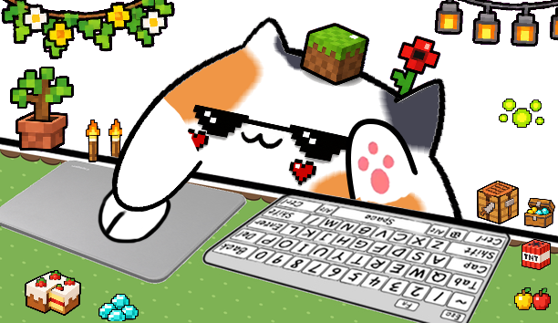

# Скины для Bongo Cat

Скины с аксессуарами, которые включаются и выключаются в приложении. Нажми на картинку или на «Скачать».

**Сначала приложение с Гардеробом:**
[⬇ Windows](https://github.com/kopch02/bongocat-skins/releases/latest/download/BongoCat-Wardrobe-Windows.zip) ·
[⬇ macOS (Apple Silicon)](https://github.com/kopch02/bongocat-skins/releases/latest/download/BongoCat-Wardrobe-macOS.zip)

## Скины

<table>
<tr>
<td width="50%" align="center">
 
<b>⛏️ Майнкрафт</b> 
шапка-крипер, блок травы, пиксельные очки, пчёлка, сундук и верстак на столе 
<a href="https://github.com/kopch02/bongocat-skins/releases/latest/download/bongocat-skin-calico_minecraft.zip"><b>⬇ Скачать</b></a>
</td>
<td width="50%" align="center">
 
<b>🌸 Милый котик</b> 
венок из цветов, бантик, круглые очки, румянец, латте и цветок на столе 
<a href="https://github.com/kopch02/bongocat-skins/releases/latest/download/bongocat-skin-peach_cozy.zip"><b>⬇ Скачать</b></a>
</td>
</tr>
<tr>
<td width="50%" align="center">
 
<b>🎄 Новогодний</b> 
шапка Деда Мороза, кокошник, ёлочка, оливье и снегопад 
<a href="https://github.com/kopch02/bongocat-skins/releases/latest/download/bongocat-skin-calico_newyear_v2.zip"><b>⬇ Скачать</b></a>
</td>
<td width="50%" align="center">
 
<b>🪝 Dead by Daylight</b> 
маска, корона из когтей, ворона, крюк и генератор на столе 
<a href="https://github.com/kopch02/bongocat-skins/releases/latest/download/bongocat-skin-calico_dbd_v2.zip"><b>⬇ Скачать</b></a>
</td>
</tr>
</table>

## Как установить

1. Скачай приложение и распакуй его.
   - **Windows:** запусти `BongoCat.exe`. Если появится SmartScreen: «Подробнее» → «Выполнить в любом случае».
   - **macOS:** перетащи `BongoCat.app` в «Программы». Приложение не подписано, поэтому при первом запуске
     открой его через правый клик → «Открыть» или выполни в Терминале
     `xattr -dr com.apple.quarantine /Applications/BongoCat.app`. Для реакции на клавиши дай доступ
     в «Мониторинге ввода».
2. Скачай архив скина и **распакуй его в отдельную папку** (файлы в архиве лежат без вложенной папки).
3. В приложении открой настройки → **Модели** → **Импорт модели** и выбери эту папку
   (или просто перетащи её в окно).
4. Выбери модель и в разделе **Гардероб** включи нужные аксессуары. Предметы на столе называются «Стол: …».

> В обычном BongoCat скин тоже откроется, но без аксессуаров.

## Благодарности

Приложение основано на [BongoCat](https://github.com/ayangweb/BongoCat) (Apache-2.0); в эту версию добавлены
Гардероб и анимация снегопада. Это фанатская работа, она не связана с авторами Bongo Cat, Minecraft
и Dead by Daylight.
