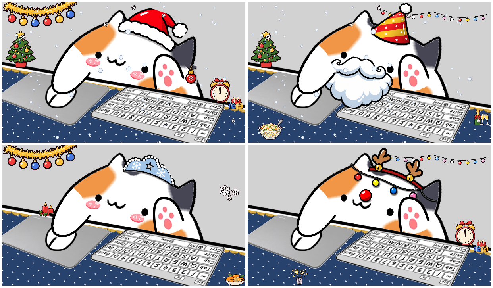
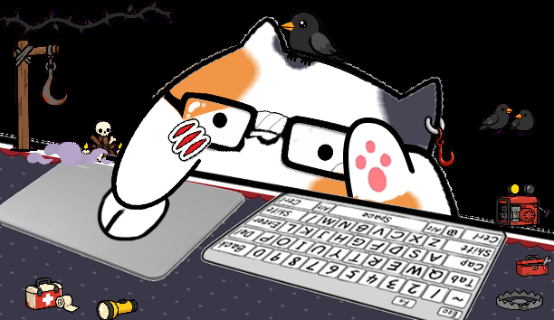
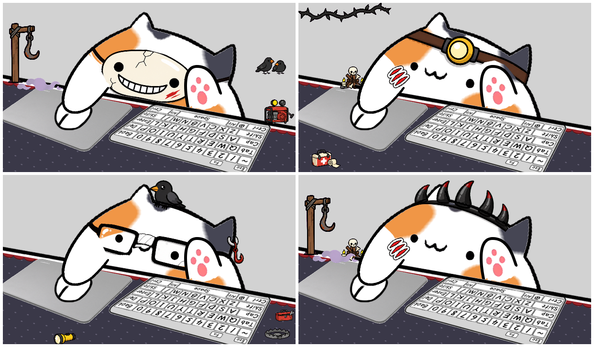

# Скины для Bongo Cat

Скины с переключаемыми аксессуарами для Bongo Cat: трёхцветная кошка, а тема задаётся аксессуарами
на голове и предметами на столе. Любые аксессуары можно включать одновременно.

> Аксессуары включаются в модифицированной версии приложения с **Гардеробом** (ссылки ниже).
> В обычном BongoCat скин тоже откроется, но без аксессуаров.

## Скачать

| | Скачать |
|---|---|
| **Приложение для Windows** (x64, портативное) | [BongoCat-Wardrobe-Windows.zip](https://github.com/kopch02/bongocat-skins/releases/latest/download/BongoCat-Wardrobe-Windows.zip) |
| **Приложение для macOS** (Apple Silicon) | [BongoCat-Wardrobe-macOS.zip](https://github.com/kopch02/bongocat-skins/releases/latest/download/BongoCat-Wardrobe-macOS.zip) |
| Новогодний скин | [bongocat-skin-calico_newyear_v2.zip](https://github.com/kopch02/bongocat-skins/releases/latest/download/bongocat-skin-calico_newyear_v2.zip) |
| Скин в стиле Dead by Daylight | [bongocat-skin-calico_dbd_v2.zip](https://github.com/kopch02/bongocat-skins/releases/latest/download/bongocat-skin-calico_dbd_v2.zip) |

---

## 🎄 Новогодний — `calico_newyear_v2`

**На голове:** шапка Деда Мороза, праздничный колпак, оленьи рожки, кокошник Снегурочки,
мандаринка на голове, гирлянда на ушках.
**На лице:** борода Деда Мороза, красный нос, морозный румянец, серьга-шарик.
**На столе:** ёлочка, мишура, гирлянда-огоньки, часы на полночь, оливье, шампанское,
бенгальские огни, подарки, мандарины, свечи, снежинки.
**Снегопад** по всему окну: снег падает в приложении по ссылке выше (в старых версиях снежинки стоят на месте).

## 🪝 Dead by Daylight — `calico_dbd_v2`

**На голове и лице:** маска с улыбкой (новая и старая), очки на изоленте, серьга-крюк, корона из когтей,
ворона на голове, налобный фонарик, наклейка-царапины.
**На столе:** крюк, генератор, тотем, ящик с инструментами, аптечка, фонарик, капкан, вороны, туман,
терновая лоза.

---

## Как установить

1. Скачай приложение для своей системы и распакуй его.
   - **Windows:** запусти `BongoCat.exe`. Если появится SmartScreen: «Подробнее» → «Выполнить в любом случае».
   - **macOS:** перетащи `BongoCat.app` в «Программы». Приложение не подписано, поэтому при первом запуске
     открой его через правый клик → «Открыть» или выполни в Терминале
     `xattr -dr com.apple.quarantine /Applications/BongoCat.app`. Для реакции на клавиши дай доступ
     в «Мониторинге ввода».
2. Скачай архив скина и **распакуй его в отдельную папку** (файлы в архиве лежат без вложенной папки).
3. В приложении открой настройки → **Модели** → **Импорт модели** и выбери эту папку
   (или просто перетащи её в окно).
4. Выбери модель, затем в разделе **Гардероб** включи нужные аксессуары. Предметы на столе
   называются «Стол: …».

## Благодарности

Приложение основано на [BongoCat](https://github.com/ayangweb/BongoCat) (Apache-2.0); в эту версию добавлены
Гардероб и анимация снегопада. Это фанатская работа, она не связана с авторами Bongo Cat и Dead by Daylight.
